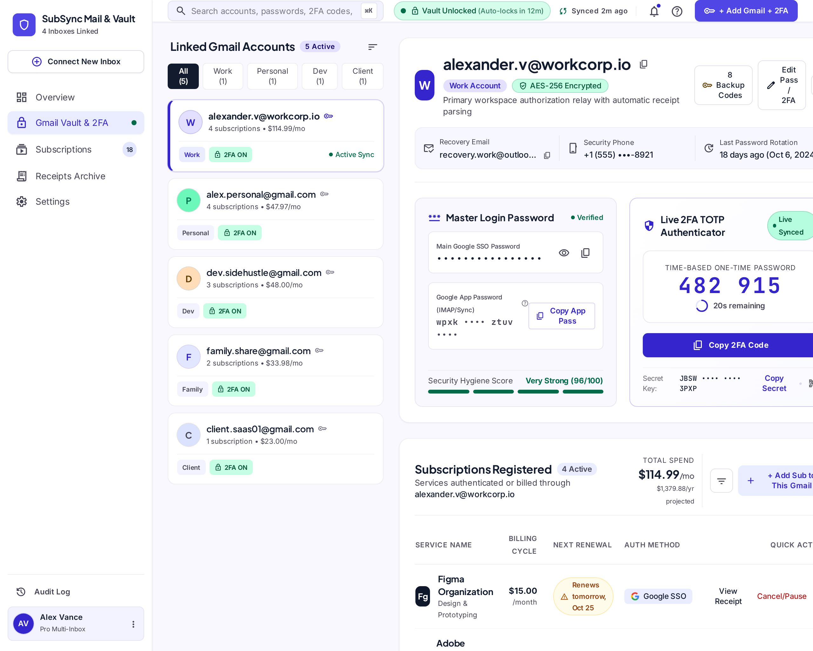

# SubMail Personal

> Ứng dụng desktop quản lý nhiều tài khoản **Gmail cá nhân** (mật khẩu + mã 2FA TOTP sống +
> mã dự phòng) kèm toàn bộ các **gói đăng ký** đã dùng dưới từng hộp thư.

Chạy hoàn toàn **offline** trên máy của bạn. Không tài khoản, không đồng bộ cloud, không
telemetry. Dữ liệu nằm trong một file JSON trên máy bạn — bạn toàn quyền sở hữu nó.

<p align="center">
  
</p>

## Mục lục

- [Tính năng](#tính-năng)
- [Cài đặt và chạy](#cài-đặt-và-chạy)
- [Tích hợp tuỳ chọn: dịch vụ tạo ảnh](#tích-hợp-tuỳ-chọn-dịch-vụ-tạo-ảnh)
- [Kiểm thử](#kiểm-thử)
- [Cấu trúc thư mục](#cấu-trúc-thư-mục)
- [Bảo mật — đọc trước khi dùng thật](#bảo-mật--đọc-trước-khi-dùng-thật)
- [Đóng góp](#đóng-góp)
- [Giấy phép](#giấy-phép)

## Tính năng

1. **Két nhiều tài khoản Gmail cá nhân**
   - Phân loại theo nhóm: *Mail Chính*, *AI & Công Cụ*, *Giải Trí*, *Học Tập / Dev*,
     *Mua Sắm / Phụ*.
   - Lưu **mật khẩu Gmail**, **email khôi phục**, **SĐT xác minh**, **App Password** và
     **8 mã dự phòng 2FA**.
2. **Mã 2FA TOTP chuẩn RFC 6238 (HMAC-SHA1)**
   - Tính bằng Go stdlib (`crypto/hmac` + `crypto/sha1`), Base32 tự giải mã.
   - Đã đối chiếu với **6 test vector chính thức của RFC 6238** (T=59 → `287082`, …).
   - Mã đổi mỗi 30 giây kèm thanh đếm ngược và thanh tiến trình.
3. **Theo dõi gói đăng ký theo từng hộp thư**
   - Phân biệt gói đăng nhập bằng **Google SSO** và gói có **mật khẩu riêng**.
   - Quy đổi chi phí sang VNĐ (`VND_RATE = 25400`), theo dõi thẻ/ví thanh toán, cảnh báo
     trial và gói sắp gia hạn.
   - Ngày gia hạn được tính lại **mỗi lần hiển thị**, không phải chuỗi lưu sẵn — không bao
     giờ bị lệch dần theo thời gian.
4. **Tạo icon AI (tuỳ chọn)**
   - Kết nối tới dịch vụ tạo ảnh **OpenAI-compatible** của chính bạn để sinh icon cho gói
     đăng ký, avatar hộp thư và icon ứng dụng.
   - **Mặc định tắt.** Xem [Tích hợp tuỳ chọn](#tích-hợp-tuỳ-chọn-dịch-vụ-tạo-ảnh).
5. **Sao lưu cục bộ**
   - **Xuất / Nhập** file sao lưu `.json` qua hộp thoại file native của hệ điều hành.
   - Ghi dữ liệu **atomic**: ghi file tạm rồi rename, nên tắt đột ngột không để lại file
     nửa vời.

> Ứng dụng **không** đóng gói sẵn dữ liệu mẫu. Lần chạy đầu tiên két sẽ trống — bạn tự thêm
> tài khoản của mình.

## Cài đặt và chạy

Bản chính là ứng dụng desktop **Go + Wails v2** trong thư mục [`desktop/`](./desktop).

### Yêu cầu

| Công cụ | Phiên bản |
|---|---|
| Go | 1.26+ |
| Node.js | 20+ |
| Wails CLI v2 | `go install github.com/wailsapp/wails/v2/cmd/wails@latest` |
| GCC (cgo) | Bắt buộc khi build trên Windows |

### Chạy ở chế độ phát triển

```bash
cd desktop
wails dev          # hot reload
```

### Build ra file thực thi

```bash
cd desktop
wails build        # -> desktop/build/bin/submail-personal.exe (Windows)
```

### Chạy thẳng bằng Go (không cần Wails CLI)

```bash
cd desktop
go build -o submail-personal .
```

## Tích hợp tuỳ chọn: dịch vụ tạo ảnh

App đi kèm một **điểm móc** cho các dịch vụ chạy trên máy bạn. Mặc định **tắt hoàn toàn**:
không có cấu hình thì app không hiện nút tạo ảnh và **không gọi ra mạng**.

### Cách bật

1. Sao chép file mẫu:

   ```bash
   cp desktop/integrations.example.json \
      "$APPDATA/SubMailPersonal/integrations.json"   # Windows
   ```

   Trên Linux/macOS: `~/.config/SubMailPersonal/integrations.json`.

2. Sửa file cho đúng với dịch vụ của bạn:

   ```json
   {
     "integrations": [
       {
         "id": "local-image",
         "name": "Dịch vụ tạo ảnh của tôi",
         "type": "image",
         "baseUrl": "http://localhost:8000",
         "apiKey": "token-của-bạn",
         "model": "",
         "enabled": true
       }
     ]
   }
   ```

3. Khởi động lại app. Nút **⚡ Icon** và **⚡ Tạo Avatar AI** sẽ xuất hiện.

Dịch vụ phải nói chuẩn OpenAI ở `POST {baseUrl}/v1/images/generations` và trả về một trong hai
dạng: `data[0].b64_json` (base64) hoặc `data[0].url` (đường dẫn tải ảnh).

### Thêm endpoint của riêng bạn

File cấu hình là **JSON thuần**, không cần sửa mã nguồn. Mỗi tích hợp có:

| Trường | Ý nghĩa |
|---|---|
| `id` | Định danh, dùng để gọi adapter |
| `name` | Tên hiển thị trên giao diện |
| `type` | Loại tích hợp — hiện hỗ trợ `image` |
| `baseUrl` | Gốc URL của dịch vụ (không có dấu `/` cuối) |
| `apiKey` | Bearer token — **chỉ nằm trong Go**, không bao giờ gửi lên frontend |
| `model` | Tên model, tuỳ dịch vụ |
| `enabled` | Bật/tắt tích hợp |

Muốn đổi vị trí file cấu hình, đặt biến môi trường:

```bash
export SUBMAIL_INTEGRATIONS_CONFIG=/duong/dan/toi/integrations.json
```

> **Lưu ý:** file cấu hình chứa `apiKey` của bạn — đừng commit nó lên Git. Repo này đã
> ignore `integrations.json` sẵn.

## Kiểm thử

Không dùng framework test — mỗi lệnh dưới đây là một bộ kiểm tra độc lập.

```bash
cd desktop
go test ./...                 # TOTP RFC 6238 + store + app + integrations

cd frontend && npm test       # esc()/escJs() chống XSS
```

### Kiểm thử thủ công

1. Mở app: két trống, không có lỗi console.
2. Thêm một tài khoản Gmail → đóng app → mở lại, dữ liệu còn nguyên trong file JSON.
3. Mã 2FA đổi mỗi 30s — đối chiếu với Google Authenticator.
4. **Khóa Két** → mọi bí mật bị che **và** mọi nút Copy bị chặn.
5. **Xuất** → **Nhập lại** → dữ liệu khôi phục đúng.
6. Đổi theme Sáng/Tối → mọi vùng đổi màu đồng bộ.

## Cấu trúc thư mục

```text
submail-personal/
├── LICENSE
├── README.md
├── SECURITY.md
├── CONTRIBUTING.md
├── index.html                   # Prototype web (tham chiếu UX, dữ liệu mẫu đã làm giả)
├── mockups/                     # Ảnh mockup giao diện
└── desktop/                     # Ứng dụng desktop Go + Wails
    ├── main.go                  # Entry point + //go:embed all:frontend/dist
    ├── app.go                   # Bound methods: state, CRUD, lock, TOTP, backup
    ├── icons.go                 # Tạo icon AI cho gói / avatar / ứng dụng
    ├── cmd/genicon/             # Tool sinh icon ứng dụng + file .ico
    ├── integrations.example.json  # Mẫu cấu hình tích hợp (không chứa bí mật)
    ├── internal/
    │   ├── model/               # GmailAccount, Subscription, State
    │   ├── totp/                # Base32 + HMAC-SHA1 TOTP (RFC 6238)
    │   ├── store/               # Đọc/ghi JSON atomic + thư mục ảnh
    │   ├── icon/                # Xử lý PNG/ICO + prompt dựng sẵn
    │   └── integrations/        # Cấu hình & adapter gọi dịch vụ tuỳ chọn
    └── frontend/
        ├── index.html           # Markup (shell sidebar + topbar)
        ├── src/main.js          # Logic giao diện, nối binding Go
        ├── src/escape.js        # esc()/escJs() — chống XSS
        ├── src/escape.test.mjs  # node --test
        ├── src/style.css        # Hệ CSS gốc (TailAdmin v2) + token sáng/tối
        └── src/assets/fonts/    # Outfit .woff2 (latin + latin-ext) — chạy offline
```

### Nguyên tắc kiến trúc

**Go giữ bí mật, frontend chỉ hiển thị.** Khi két khóa, `GetState()` trả về mask thay vì giá
trị thật và `RevealSecret` / `RevealCustomPass` **từ chối** ở tầng Go. Sửa logic bảo mật ở
một chỗ ở Go, đừng vá từng nút copy ở JS.

Mọi dữ liệu người dùng chèn vào HTML phải qua `esc()` (text node) hoặc `escJs()` (chuỗi
trong `onclick`) — đây là hàng rào chống XSS.

## Bảo mật — đọc trước khi dùng thật

- **"Khóa Két" chỉ là che hiển thị ở tầng giao diện.** Bí mật vẫn nằm trong file JSON
  **dạng rõ** dưới `%AppData%`. Bản này **không mã hoá at-rest** — đừng mô tả tính năng
  này là mã hoá.
- **File sao lưu `.json` chứa toàn bộ bí mật ở dạng rõ.** Đừng chia sẻ file backup.
- **Không dùng làm password manager.** Đây là công cụ theo dõi gói đăng ký và mã 2FA cho
  tài khoản *phụ* của chính bạn. Hãy bật 2FA của Google và dùng trình quản lý mật khẩu
  chuyên dụng cho mật khẩu chính.
- Vì dữ liệu nằm trên máy bạn, hãy bảo vệ bằng mật khẩu đăng nhập Windows/macOS và mã
  hoá ổ đĩa.

Chi tiết và cách báo lỗi bảo mật: [`SECURITY.md`](./SECURITY.md).

## Đóng góp

Xem [`CONTRIBUTING.md`](./CONTRIBUTING.md). Tóm tắt:

```bash
cd desktop && go test ./... && cd frontend && npm test
```

Chuỗi hiển thị trên giao diện bằng **tiếng Việt**, comment trong mã bằng **tiếng Anh**.

## Giấy phép

[MIT](./LICENSE) © Ngô Tiến Phong
